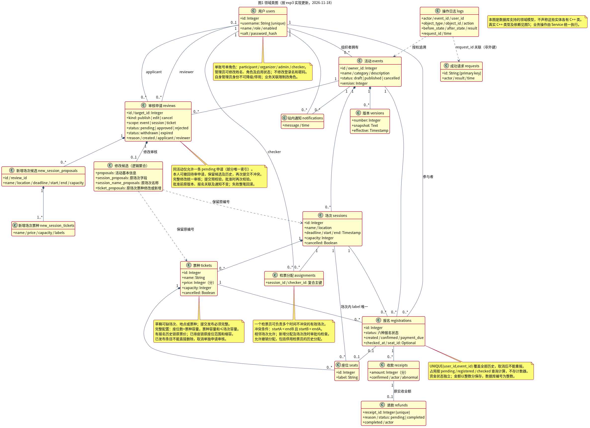
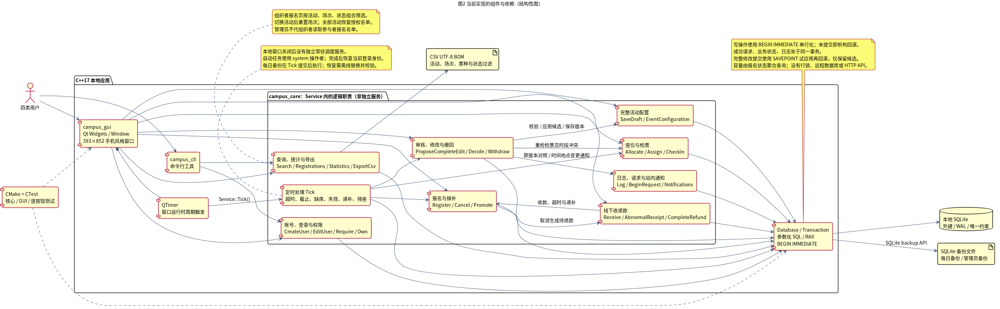
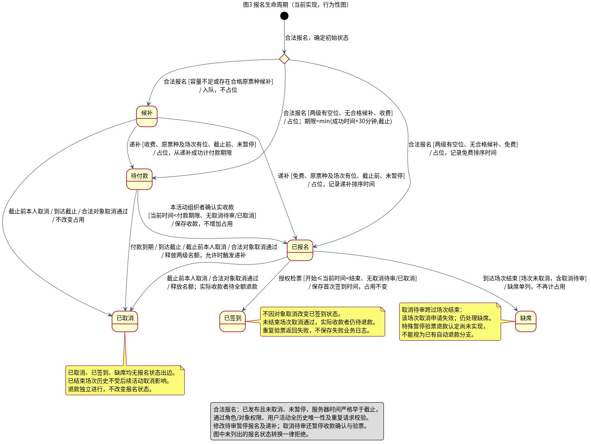
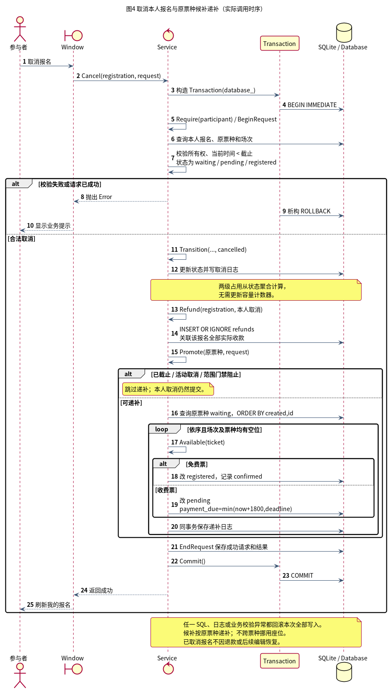
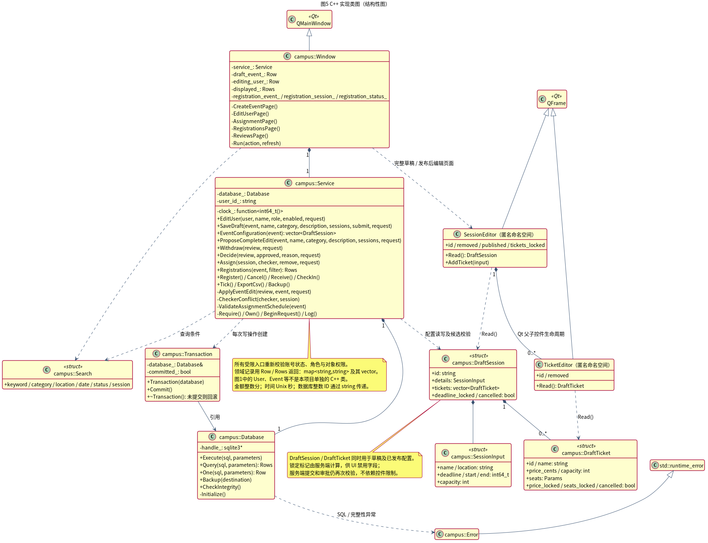
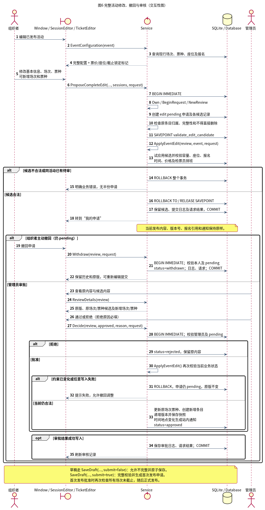

# 校园活动系统 UML（与 exp3 实现同步）

更新日期：2026-11-18。依据当前 `exp3/include/campus/`、`exp3/src/` 的 C++17、Qt Widgets 和 SQLite 实现更新。此目录是设计图及技术说明，不是课程实验报告正文。

## 图像索引

| 图 | 类型 | 内容 | 可编辑源文件 | 导出图片 |
| --- | --- | --- | --- | --- |
| 图1 领域类图 | 结构性：类图 | 用户、活动、场次、票种、报名、审核候选、资金及检票关系 | [PUML](01_类图.puml) | [PNG](01_类图.png) · [SVG](01_类图.svg) |
| 图2 组件图 | 结构性：组件图 | Qt/CLI、Service 逻辑职责、SQLite 事务、定时处理及构建测试 | [PUML](02_组件图.puml) | [PNG](02_组件图.png) · [SVG](02_组件图.svg) |
| 图3 报名状态图 | 行为性：状态图 | 六种报名状态、付款、候补、取消、签到及缺席 | [PUML](03_状态图.puml) | [PNG](03_状态图.png) · [SVG](03_状态图.svg) |
| 图4 取消与递补时序图 | 交互性：时序图 | `Cancel → Transition → Refund → Promote` 的实际事务流程 | [PUML](04_时序图.puml) | [PNG](04_时序图.png) · [SVG](04_时序图.svg) |
| 图5 C++ 实现类图 | 结构性：类图 | `Window / Service / Database / Transaction` 和编辑配置结构体 | [PUML](05_实现类图.puml) | [PNG](05_实现类图.png) · [SVG](05_实现类图.svg) |
| 图6 完整编辑审核时序图 | 交互性：时序图 | 完整修改、保存点预校验、撤回、拒绝及批准后的统一生效 | [PUML](06_完整编辑审核时序图.puml) | [PNG](06_完整编辑审核时序图.png) · [SVG](06_完整编辑审核时序图.svg) |

共有六张图，涵盖类图、组件图、状态图、时序图四种 UML 类型及结构、行为、交互三类。图5是同一种类图的代码视角，图6是同一种时序图的另一业务场景，不重复计算类型。

## 本次同步内容

| 修改 | 图中表达 | 对应代码 |
| --- | --- | --- |
| 完整草稿 | 可一次编辑活动、多个场次、票种、价格、容量与座位；暂存允许不完整，发布需完整校验 | `Service::SaveDraft`、`DraftSession`、`DraftTicket` |
| 完整发布后编辑 | 旧条目保留 ID，可新增场次和票种；统一生成修改审核，批准前不改变原版 | `EventConfiguration`、`ProposeCompleteEdit`、`ApplyEventEdit` |
| 修改预校验 | 保存候选后使用 SAVEPOINT 试应用，再回滚试应用，仅保留候选；批准时重检 | `ProposeCompleteEdit`、`Decide` |
| 原价、座位及截止保护 | 有报名历史不能改原价；已排座不能改原座位范围或缩容；原截止已到或有待付款报名时不允许改截止 | `EventConfiguration`、`ApplyEventEdit` |
| 撤回申请 | 本人撤回仍待审申请；历史保留，同活动只有一条待审申请，再次申请不触发旧唯一约束 | `Withdraw`、`NewReview`、`one_pending_review` |
| 编辑账号 | 修改姓名、角色和启用状态；不能停用或降级自己，业务历史限制改角色 | `EditUser`、`Window::EditUserPage` |
| 检票员增删分配 | 场次与检票员组成复合主键，待分配/已分配列表分开，可撤销停用人员的授权 | `AssignmentSessions`、`AssignmentCheckers`、`Assign` |
| 多场次检票与时间冲突 | 一人可负责多个有效场次，`startA < endB && startB < endA` 为冲突，相邻场次允许；改时批准重检 | `CheckerConflict`、`ValidateAssignmentSchedule` |
| 报名组合筛选 | 活动、场次、状态联动过滤；切换活动重置场次 | `Search`、`Registrations`、`Window::RegistrationsPage` |
| 实际架构与存储 | 本地 Qt/CLI，不是 HTTP 服务；SQLite `BEGIN IMMEDIATE`，不是数据库行锁；占用按报名状态查询计算 | `Window`、`Service`、`Database`、`Transaction` |

## 如何阅读类图

图1是领域/持久化模型：中文实体对应数据库记录，`Candidate` 是多张候选表的逻辑聚合，不是额外的一张表，也不是实际 C++ 类。草稿允许没有场次或票种，因此这些组合关联的最小数量为 0；提交发布才强制每个活动至少一场、每场至少一票种。

图5才是实际 C++ 类结构。当前代码用 `Row = map<string,string>`、`Rows = vector<Row>` 表示数据库实体，业务规则集中在 `Service`，不应把图1误读为源码存在 `User`、`Event`、`Registration` 类。SQL 主键是整数；接口常用 `string` 传递编号；金额用整数分，时间用 Unix 秒。

`SessionEditor`、`TicketEditor` 是 `window.cpp` 匿名命名空间里的 Qt 控件类，复用完整表单处理草稿与已发布活动；锁定标记仅辅助 UI，服务端仍执行权限与约束校验。

## 实现边界

- 单账号单角色，角色之外仍检查对象所有权、本人报名或检票分配。管理员不代组织者读取参与者报名名单。
- 待审修改暂停报名和递补；待审取消还按目标范围暂停收款与检票。撤回申请解除相应待审门禁；后续定时任务按当前时间规则处理。
- 报名具有六种状态；`UNIQUE(user_id,event_id)` 覆盖全历史，因此取消后不能在同一活动重报。待付款、已报名、已签到计入占用；候补不占用。
- SQLite 写事务串行化，状态变更、业务日志和成功请求记录同事务提交。并发工作者各用独立连接；不是基于行锁的服务器架构。
- Qt 窗口每秒触发 `Tick()`，处理超时、截止、缺席、取消申请失效、递补及排座；没有窗口关闭后仍运行的独立定时服务。Tick 提交后检查每日备份。
- 通知目前是数据库站内通知，不包含短信、邮件或推送。未实现特殊暂停验票退款认定流程，不把它画成自动分支。
- 管理员可校验完整性及备份；恢复是停止程序后替换数据库并校验，没有图形化在线恢复服务。图片不代替性能、并发或恢复验证。

## 预览

### 图1：领域类图



### 图2：组件图



### 图3：报名状态图



### 图4：取消与递补时序图



### 图5：C++ 实现类图



### 图6：完整编辑审核时序图



## 重新生成

在仓库根目录运行，本机使用 PlantUML、Graphviz 和 Noto CJK 字体：

```bash
java -Djava.awt.headless=true -jar /usr/share/plantuml/plantuml.jar -charset UTF-8 -checkonly exp2/UML/*.puml
java -Djava.awt.headless=true -jar /usr/share/plantuml/plantuml.jar -charset UTF-8 -tpng exp2/UML/*.puml
java -Djava.awt.headless=true -jar /usr/share/plantuml/plantuml.jar -charset UTF-8 -tsvg exp2/UML/*.puml
```

本次只更新 `exp2/UML` 的源图、导出图和说明；UI 原稿与实验报告正文未修改。使用方法见 [exp3 代码架构与使用说明](../../exp3/代码架构与使用说明.md)。设计仍应由本人审阅后使用。
