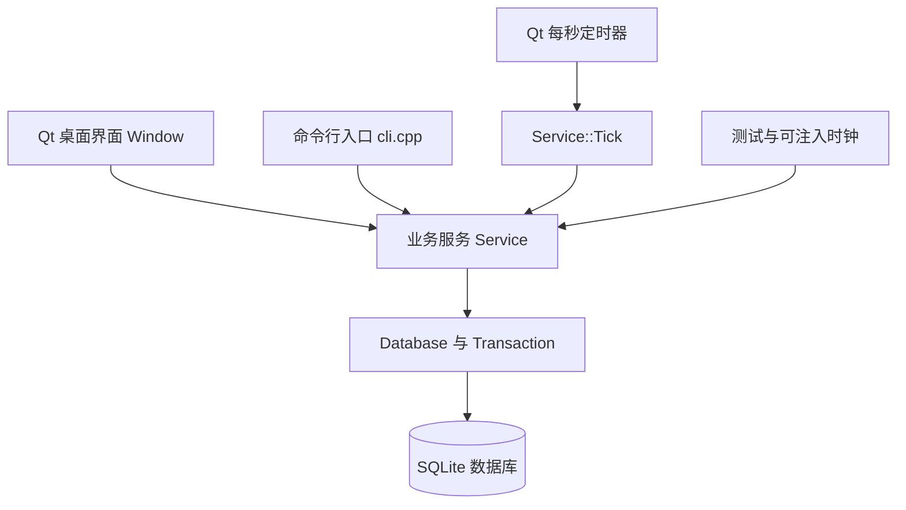
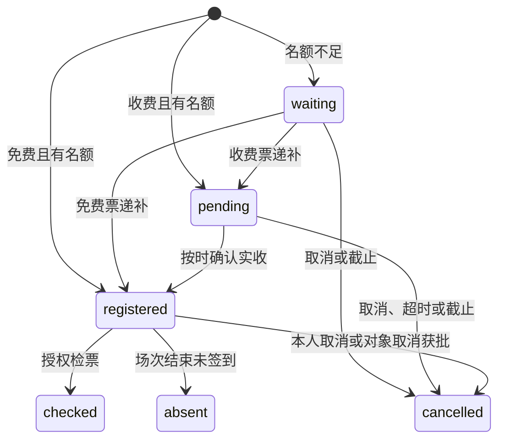

# 校园活动票务与报名系统：代码架构与使用说明

本文是当前程序的开发与操作文档，说明源码组织、业务规则、构建方式和操作步骤。命令默认从仓库根目录 `SE` 执行，路径中的 `exp3` 指本实验的程序目录。

## 1. 程序概览

程序采用 C++17、Qt Widgets 和 SQLite 实现，提供桌面图形界面和辅助命令行入口。所有业务数据存放在本地数据库中，无需单独启动数据库服务器。

主要功能包括：

- 参与者发现活动、组合筛选、选择票种报名、候补、取消报名、查看通知和本人日志。
- 组织者维护活动草稿、场次、票种与座位，提交发布、修改或取消审核，确认线下收退款，查看统计和导出名单。
- 管理员创建、编辑和停用账号、审核申请、分配检票人员、查询日志和备份数据库。
- 检票人员查看分配场次的报名记录，并在活动进行期间签到。
- 后台处理付款超时、报名截止、候补递补、座位分配、缺席和每日备份。

系统只登记实际发生的线下收款、退款，不接入在线支付。

## 2. 快速启动

### 2.1 在当前机器启动

```bash
./exp3/tools/run.sh
```

启动脚本会使用 `exp3/build/campus_gui`。如果可执行文件不存在，会先调用构建脚本。未带参数时，默认使用 `exp3/build/demo.db`；该文件不存在时，自动建立演示数据库。

当前机器已经在 `exp3/build/deps/usr` 准备了本地构建和运行依赖，脚本会自动设置所需环境变量。

### 2.2 演示账号

| 账号 | 角色 | 初始用途 |
| --- | --- | --- |
| `student` | 参与者 | 查看自己的音乐会待付款报名 |
| `student2` | 参与者 | 查看已取消音乐会报名及免费讲座报名 |
| `organizer` | 组织者 | 管理演示活动、收款和退款 |
| `admin` | 管理员 | 审核、账号管理、检票分配 |
| `checker` | 检票人员 | 查看已分配的音乐会场次并检票 |

所有演示账号的密码均为：

```text
Campus2026!
```

登录角色由数据库中的账号决定，不通过界面选择身份来获得权限。

### 2.3 演示数据与时间

演示库包含音乐会和免费讲座，以及待付款、已取消待退款、免费已报名等记录。演示场次时间根据**建库时的系统时间**生成：音乐会在约两小时后截止、三小时后开始。

付款期限通常为报名成功后 30 分钟，因此较早创建的演示记录可能已经超时。重新启动程序会继续使用原数据库，不会重置业务时间或恢复已取消的报名。

需要重新体验完整流程时，请使用一个尚不存在的新数据库文件：

```bash
./exp3/tools/run.sh --db exp3/build/demo-fresh.db --demo
```

后续打开同一数据库时去掉 `--demo`：

```bash
./exp3/tools/run.sh --db exp3/build/demo-fresh.db
```

`--demo` 只允许用于没有账号的空数据库，不能用于覆盖已有数据。

## 3. 目录结构

```text
exp3/
├── CMakeLists.txt                 CMake 构建入口
├── .clang-format                 C++ 格式配置
├── CPPLINT.cfg                   cpplint 检查配置
├── .gitignore                    构建产物与数据文件忽略规则
├── include/campus/
│   ├── database.h                数据访问、事务、通用类型和工具函数声明
│   ├── service.h                 业务服务及输入参数声明
│   └── window.h                  Qt 主窗口及页面函数声明
├── src/
│   ├── database.cpp              SQLite 封装、建表、完整性检查和备份
│   ├── service.cpp               权限、审核、报名、资金、检票和定时任务
│   ├── window.cpp                图形界面、操作对话框和信号连接
│   ├── main.cpp                  图形程序入口、启动参数和数据路径
│   └── cli.cpp                   命令行程序入口及交互命令
├── tests/
│   ├── core_tests.cpp            业务集成测试、并发与故障注入测试
│   ├── gui_tests.cpp             中文表单、完整草稿编辑与提交的界面测试
│   └── button_tests.cpp          四类角色的逐按钮、弹窗与文件结果测试
├── tools/
│   ├── environment.sh            设置本地依赖环境
│   ├── build.sh                  配置、构建并运行测试
│   ├── run.sh                    启动图形程序
│   └── benchmark.cpp             一万条报名数据的并发查询测试
├── evidence/
│   ├── tests.txt                 已执行测试的输出
│   ├── benchmark.txt             已执行性能测试的逐次耗时
│   └── screenshots/              各角色页面启动检查截图
└── build/                        本机生成的程序、依赖和演示数据库
```

`build/` 是生成目录，不是源码。当前机器的本地依赖和默认演示数据也在其中，因此删除整个目录会同时删除这些内容。

## 4. 总体架构

系统采用单进程分层结构，图形界面和命令行复用同一个业务服务。



### 4.1 界面层：Window

`Window` 继承 `QMainWindow`，负责生成界面和收集用户输入，不直接执行 SQL。

核心函数：

| 函数 | 作用 |
| --- | --- |
| `LoginPage()` | 登录和首次初始化管理员 |
| `Shell()` | 根据角色建立顶部栏、滚动内容区和固定底部导航 |
| `ShowPage()` | 清理原页面并加载目标页面 |
| `SetRecords()` | 将业务返回的记录展示为竖屏卡片 |
| `Selected()` | 获取当前选中的记录 |
| `Run()` | 捕获异常、显示提示并按需要刷新页面 |
| `EventsPage()` | 活动查询及组织者维护入口 |
| `RegistrationsPage()` | 报名、收退款或检票工作台 |
| `ReviewsPage()` | 审核列表、内容对照和审批入口 |
| `StatisticsPage()` | 票种统计和名单导出 |

例如，组织者点击收款按钮后，界面先询问是否已经实际收到线下款项，再调用 `Service::Receive()`。业务层仍会重新检查组织者归属、报名状态和付款期限。

UI 使用手工编写的 Qt Widgets 代码，按 `exp2/UI界面` 的 393 × 852 竖屏原稿恢复顶部栏、固定底部导航、绿色分类横幅和卡片列表。活动详情和选择票种采用独立竖屏页面；扩展操作、消息通知、我的申请和备份入口位于右上角“⋯”菜单。程序仍是在 Linux 上运行的 Qt 桌面应用。

### 4.2 业务层：Service

`Service` 是业务操作的统一入口。每个实例持有数据库连接、当前登录用户编号和时钟函数。

| 业务部分 | 主要接口 |
| --- | --- |
| 账号与认证 | `Bootstrap`、`Login`、`Require`、`CreateUser`、`EditUser`、`SetEnabled` |
| 活动草稿 | `DraftSessions`、`SaveDraft`、`CreateEvent`、`EditDraft`、`AddSession`、`AddTicket`、草稿编辑删除接口 |
| 审核与版本 | `Submit`、`ProposeEdit`、`ProposeSession`、`ProposeTicket`、`Decide` |
| 取消审核 | `RequestCancellation`、`Withdraw` |
| 报名与候补 | `Register`、`Cancel`、`Promote`、`Transition` |
| 收退款 | `Receive`、`AbnormalReceipt`、`Refund`、`CompleteRefund` |
| 检票与排班 | `AssignmentSessions`、`AssignmentCheckers`、`Assign`、`CheckerConflict`、`ValidateAssignmentSchedule`、`CheckIn` |
| 查询与导出 | `Events`、`Registrations`、`Statistics`、`Logs`、`ExportCsv` |
| 定时任务与备份 | `Tick`、`Allocate`、`Backup`、`CheckIntegrity` |

权限检查分为三部分：

1. `Require()` 检查登录状态、账号是否启用以及角色。
2. `Own()` 检查组织者是否拥有目标活动。
3. 具体业务检查报名归属、场次分配、活动状态和时间范围。

因此，即使调用者绕过界面直接调用业务接口，仍然需要通过相应权限检查。

### 4.3 数据访问层：Database

`Database` 封装 SQLite C API，提供：

- `Execute()`：执行写入或数据库配置语句。
- `Query()`：返回多条记录。
- `One()`：要求返回恰好一条记录。
- `Scalar()`：读取单个值。
- `LastId()`：读取当前连接最近插入的整数编号。
- `Backup()`：通过 SQLite Backup API 生成一致性备份。
- `CheckIntegrity()`：检查 SQLite 完整性、外键及部分业务约束。

SQL 参数通过预编译语句绑定。`Database` 和 `Transaction` 禁止复制，避免重复释放数据库句柄或混淆事务归属。

### 4.4 数据表示和 UML 的对应方式

UML 中的用户、活动、场次、票种、座位、报名、审核、收退款和操作日志，主要对应数据库表。当前实现没有逐一建立同名实体类，而是通过 `Row` 和 `Rows` 在业务层与界面层之间传递记录。

```cpp
using Row = std::map<std::string, std::string>;
using Rows = std::vector<Row>;
using Params = std::vector<std::string>;
```

`SessionInput` 表达场次输入，`Search` 表达组合查询条件。`Value()` 读取字符串字段，`Number()` 将字段转换为整数。

这种实现减少了原型中的实体映射代码，但字段名错误和部分类型错误只能在运行时发现。后续扩大项目时，可以将核心记录逐步改为强类型结构体，并将 `Service` 按业务模块拆分。

### 4.5 事务、并发和日志

关键写操作采用以下结构：

```cpp
Transaction transaction(database_);
Require("participant");
BeginRequest(request);
// 校验、修改业务记录、写入操作日志
EndRequest(request, result);
transaction.Commit();
```

`Transaction` 构造时执行 `BEGIN IMMEDIATE`；只有显式提交才保留变更，否则析构时回滚。

数据库开启外键校验和 WAL 模式，并设置 10 秒忙等待。多个业务服务实例使用各自的连接，SQLite 将写事务串行执行，随后在事务内重新读取容量与状态，避免同时抢占最后一个名额。

容量没有单独保存为可变的“占用计数”字段，而是根据 `pending`、`registered`、`checked` 报名实时统计。这样可以减少计数与报名状态不同步的风险。

成功请求编号保存在 `requests` 表中。重复编号会被拒绝；校验失败的请求不写入成功请求记录，也不新增失败业务日志。`OperationResult()` 只允许查询当前用户自己的成功请求；返回 `unknown` 仅表示未查到成功记录，不代表能够区分“处理中”和“明确失败”。

## 5. 数据表和业务约束

| 表 | 主要内容 |
| --- | --- |
| `users` | 账号、姓名、单一角色、密码盐与散列、启停状态 |
| `events` | 活动所属组织者、名称、类别、介绍、发布状态和版本号 |
| `sessions` | 活动场次、地点、截止/开始/结束时间、容量和取消标记 |
| `tickets` | 票种所属场次、名称、价格、容量和取消标记 |
| `seats` | 座位所属场次、票种和显示编号 |
| `registrations` | 报名所属用户与活动路径、状态、期限、确认和签到时间、座位 |
| `reviews` | 发布、修改或取消申请及审核状态 |
| `proposals` | 候选活动内容 |
| `session_proposals` | 候选场次内容 |
| `ticket_proposals` | 候选票种或新增票种内容 |
| `versions` | 已批准发布版本的文本快照 |
| `receipts` | 实际线下收款，包括异常实收 |
| `refunds` | 关联原收款的全额退款任务及完成状态 |
| `assignments` | 检票人员与场次的授权关联 |
| `logs` | 成功业务操作、状态变化、审核结果及请求编号 |
| `requests` | 成功请求及其返回结果 |
| `notifications` | 发给参与者的站内变更通知 |

主要约束：

- 同一用户、同一活动仅有一条报名记录，取消后也不能换场次重新报名。
- 同一活动至多存在一条待审核申请，因此修改审核和取消审核互斥。
- 同一场次座位编号唯一，同一座位最多分配给一条报名。
- 每个票种的座位数等于票种容量，票种容量总和不超过场次容量。
- 同一报名至多有一笔正常收款；异常实收单独记录。
- 每笔原收款最多对应一个退款任务。
- 同一检票人员可负责多个场次，但未取消的有效场次之间不得有时间重叠，跨活动也同样检查。

金额以整数“分”存储，例如 `2000` 表示 20 元。时间以 Unix 秒存储，界面按本机时区显示；手工输入格式为 `YYYY-MM-DD HH:MM`。业务对象编号使用 SQLite 整数主键，界面展示的编号不是 UUID。

密码使用随机盐和 `crypt_r` 的 SHA-512 crypt 格式散列，数据库不保存明文密码。当前代码依赖 Linux 的 libcrypt。

## 6. 报名、审核及后台任务规则

### 6.1 报名状态

| 内部状态 | 含义 | 是否计占用 |
| --- | --- | --- |
| `waiting` | 候补 | 否 |
| `pending` | 待付款 | 是 |
| `registered` | 已报名 | 是 |
| `cancelled` | 已取消 | 否 |
| `checked` | 已签到 | 是 |
| `absent` | 缺席 | 否 |

当前通用状态翻译会把 `pending` 显示为“待处理/待付款”；在报名列表中应理解为待付款，在审核列表中应理解为待审核。



收费票付款期限为 `min(成功占位时间 + 30分钟, 报名截止时间)`。候补不提前计算付款期限，递补成功时才开始计时。

候补按申请时间、同时间按报名整数编号排序，只递补原票种。报名、付款、自行取消等截止判断均使用严格的“小于”；达到截止或付款期限时就不能继续执行对应操作。

### 6.2 审核门禁

- 发布审核通过后，活动进入已发布状态并保存第一个版本快照。
- 修改审核期间保留原内容，暂停该活动的新报名和递补，仍可按原规则收款、签到和本人取消。
- 取消审核在申请范围内暂停报名、递补、收款确认和检票。
- 拒绝申请必须填写原因，拒绝本身是需要记录日志的已完成审核操作。
- 批准修改时重新检查时间、容量、票价和座位约束；任一检查失败，整次批准回滚，申请仍待审核。
- 有报名历史后不能修改原票价，应通过修改申请新增票种。

### 6.3 后台任务

图形程序通过每秒触发的 Qt 定时器调用 `Service::Tick()`。任务依次执行超时与截止清理、缺席处理、场次/票种取消申请失效、候补递补和座位分配。

座位在报名截止后分配给已报名记录，收费票按实际收款确认时间、免费票按成功报名或递补时间排序，同时间按报名编号，再按座位编号的字符串顺序分配。建议使用 `A01,A02,...,A10` 这种等宽编号。

已分配座位不会在重复任务中重新排列。当前实现会在取消待审核期间暂停受影响票种的排座，这是对尚未确定需求的当前处理方式。

图形程序关闭后，每秒任务也停止。需要在无界面环境定期处理时，可以用系统调度器调用 CLI 的 `tick` 命令。重新执行任务时会根据当前时间补处理，不需要手工修改状态。

任务成功提交后，会在数据库旁生成当天首次执行时的每日备份。例如 `demo.db.daily-2026-11-11.bak`。它不是持续同步备份，也不会每天更新同一个备份文件；程序当天未运行任务，就不会生成当天备份。

## 7. 图形界面详细操作

### 7.1 组织者：创建并发布活动

1. 使用 `organizer` 登录，进入“我的活动”，点击“新建活动”。
2. 在主窗口的完整竖屏表单中填写名称、类别和多行简介。
3. 向下滚动，在“场次 1 · 报名设置”中填写场次名称、地点、报名截止、开始、结束时间和场次总容量。
4. 在场次内部填写票种名称、价格（单位为元，免费填 0）、票种容量和座位编号。
5. 座位编号可以用逗号或换行分隔，也可以填写前缀后点击“按容量生成座位编号”。同一场次的不同票种应使用不同座位范围。
6. 点击场次内部的“添加票种 ＋”增加票种；点击表单下方的“添加场次 ＋”增加场次。每个场次分别配置时间、容量和票种。移除按钮仅在本次保存成功后更新数据库。
7. 点击“保存活动草稿”可以保存尚未填写完整的内容。返回活动列表后，草稿卡片显示已配置的场次和票种数量；点击“编辑活动”会载入全部配置，可继续修改。
8. 配置完成后，点击表单底部“保存并提交发布审核”，或在草稿卡片上点击“提交发布审核”。
9. 管理员使用 `admin` 登录，在“活动审核”核对申请并批准；通过后活动自动发布，参与者可以报名。

**保存草稿与发布审核是两个阶段。** 保存草稿仅要求活动名称及基础数值合法，允许类别、介绍、场次地点或座位配置暂不完整；提交审核则要求活动基本信息、场次和票种完整，且每个场次满足 `报名截止 ≤ 开始 < 结束`、截止时间尚未到达、票种容量总和不超过场次容量、座位数等于各票种容量。缺失配置时会提示并保留表单内容，组织者不能绕过管理员直接发布。

`SaveDraft()` 将基本信息、多个场次、票种、座位和操作日志放在同一个事务内保存；选择提交时，审核申请也在同一事务中创建。任一校验或写入失败都会回滚，不会留下只保存了部分场次的活动。编辑时保留未移除场次和票种的原编号；待审草稿须先撤回申请才能保存修改。

右上角菜单仍保留原有单独维护场次、票种等快捷操作，完整编辑不再依赖这些菜单。

### 7.2 参与者：查询与报名

1. 登录后进入“发现活动”。
2. 输入关键词、类别、地点和日期，点击“组合筛选”。类别为精确匹配，日期格式为 `YYYY-MM-DD`，已填写的条件同时生效。
3. 在活动卡片中点击“查看活动 ›”，进入竖屏活动详情页。
4. 选择场次和票种并确认。
5. 进入“我的报名”查看报名编号、状态、付款期限和座位。

免费票有位时直接已报名，收费票有位时待付款，满额则候补。付款需在线下完成并由组织者确认，参与者不能自行把记录改为已付款。

截止前可选中本人记录点击“取消本人报名”。取消已付款报名会生成待全额退款任务，但不会自动转账。已取消记录不能重新报名同一活动。

### 7.3 组织者：报名筛选、收款与退款

底部导航显示“报名管理”，内部页面及部分菜单沿用“报名与收退款”名称，均指同一工作台。

1. 在“活动”下拉框选择自己组织的活动，默认“全部活动”。
2. 选择活动后，“场次”下拉框启用，仅列出该活动的场次，并显示开始时间及编号；“全部场次”查询该活动的所有场次。
3. 结合报名状态筛选，三个条件同时生效；无匹配时显示“暂无记录”。
4. 切换活动时重置场次；选择“全部活动”后，场次选择禁用。收退款操作成功刷新页面后保留筛选条件，退出登录后清空。
5. 在筛选结果中选择具体报名，再进行以下操作：

- 正常收款：先核实实际收到款项，再点击“确认已收到线下付款”。金额必须等于票价且仍在付款期限内。
- 异常实收：对超时或取消后实际收到的款项，使用异常实收入口填写实际金额，单位为分。系统记录待全额退款，不恢复报名。
- 退款完成：先在线下全额退还，再点击退款确认入口，选择对应原收款的退款任务。

`student2` 的音乐会报名在演示库中已取消，组织者可以用它体验待退款处理。重复收款、重复退款和跨组织者资金操作会被拒绝。

### 7.4 组织者与管理员：发布后修改

1. 组织者进入“我的活动”，点击活动卡片的“编辑活动”，或选中活动后从菜单选择“编辑活动 / 申请发布后修改”。
2. 完整页面自动载入活动名称、类别、简介，以及全部场次和票种。可以修改场次名称、地点、报名截止、开始和结束时间、容量，以及票种名称、价格、容量和座位编号。
3. 使用“添加场次 ＋”“添加票种 ＋”补充新内容；新增条目可移除。原已发布场次和票种不能在编辑中直接删除，需要另行申请取消。
4. 点击“提交修改审核”，活动、场次、票种和新增内容共同形成一条修改申请。提交时校验完整候选配置；失败时整笔回滚，不留下半份申请。
5. 管理员在“活动审核”查看原内容与候选内容，通过后全部改动一次生效；拒绝或组织者撤回均保留原版本。审核时再次检查时间、报名、座位和检票员冲突，防止提交后状态变化导致违规。

有报名历史的原票种价格只读；已分配座位的原票种座位范围和容量只读。报名截止已到或存在待付款报名时，原截止时间不能修改。已开始、已取消的场次及已截止票种的相关字段锁定。需要调整票价时可新增票种。时间或地点变更获批后，受影响参与者可在“消息通知”查看通知。

实现入口为 `EventConfiguration`（加载完整配置和字段锁定标记）、`ProposeCompleteEdit`（保存完整候选并通过保存点预校验）和 `ApplyEventEdit`（审核通过时原子应用）。新增场次候选保存于 `new_session_proposals`、`new_session_tickets`，场次名称候选保存于 `session_name_proposals`；启动时自动创建新表，已有业务数据保留。旧菜单中的“为修改申请添加场次变更”和“为修改申请修改 / 新增票种”仍可补充待审申请。

#### 主动撤回未审核申请

组织者可以主动撤回本人活动的待审核申请，包括首次发布、修改和取消申请：

1. 进入“我的活动”，在对应活动卡片上点击“撤回待审核申请”。卡片同时显示待审申请类型。
2. 也可以点击活动页的“我的申请 · 查看 / 撤回”，在待审申请卡片中点击“撤回申请”。右上角“⋯”仍保留“我的申请”入口。
3. 成功后申请状态变为“已撤回”，记录与候选内容保留供追溯，原发布版本不变；首次发布申请撤回后仍为草稿。
4. 随后可重新编辑或提交新申请。修改或取消申请撤回后，相应业务门禁解除；候补递补按现行时间规则由后台任务继续处理。

同一活动只能有一条待审核申请。有待审申请时，活动卡片提供“查看待审核申请”和撤回入口，不再引导创建重复申请。后端也会提示现有申请类型和编号，要求先撤回或等待审核，不再直接暴露 `UNIQUE constraint failed: reviews.event_id`。

只有活动所属组织者能撤回，管理员和其他组织者不能代撤回。已批准、拒绝、撤回或失效的申请不能再次撤回。撤回与管理员批准并发时只有一个操作能成功，旧页面不能批准已撤回的申请。

### 7.5 组织者与管理员：取消活动、场次或票种

1. 组织者在“我的活动”选中活动，点击取消申请入口。
2. 输入 `event`、`session` 或 `ticket` 指定范围，并选择目标。
3. 管理员审核通过后，处理受影响且未结束场次的报名和退款。
4. 已签到报名保留已签到状态；存在实收款时仍可产生退款任务。

场次及票种取消申请跨过场次结束时间时，后台会将其标为失效。已结束场次的历史不因后续活动取消而改写。

### 7.6 管理员：账号与检票分配

“账号管理”支持创建账号、编辑姓名和角色、启用及停用账号。每个账号只能有一个角色，创建时密码至少 8 位。

修改创建时填错的账号：

1. 管理员进入“账号管理”，找到目标账号，点击卡片上的“编辑 ›”。
2. 在主窗口的“编辑账号”页面修改姓名、身份 / 角色及启用状态。
3. 点击“保存账号修改”。返回账号列表后可查看最新信息。

登录名在此页面只读，密码也不会因编辑而变化。中文姓名使用主窗口内的普通输入框，支持中文输入法。

没有业务关联的新账号可直接纠正角色，例如将误建为参与者的 `checker2` 改成检票人员。若检票人员已有分配，先在“检票分配 → 撤销已有分配”撤销该人员的全部场次授权，再改角色。已有活动、报名、审核或资金确认历史的账号不能直接改角色，页面会说明原因；这些账号仍能单独修改姓名或启停状态。拒绝角色修改时不会只保存一半字段。

当前管理员可修改自己的姓名，但不能在此页面停用自己或更改自己的角色。所有更新均由业务层重新校验管理员身份，并将账号字段和操作日志一起提交；其他已登录会话下次调用服务时会重新读取角色和启用状态。当前界面没有密码重置入口。

新增检票账号：

1. 进入“账号管理”，点击“创建新账号”。
2. 填写账号、姓名及至少 8 位密码，角色选择“检票人员”。
3. 回到“检票分配”，点击“刷新活动与人员”。创建账号与分配场次是两个独立操作。

新增分配：

1. 选择“新增分配”模式。
2. 选择活动和场次。只显示已发布、未取消、未结束且有可用票种的场次。
3. 查看“当前已分配”人员。候选列表只显示启用、尚未分配到此场次且没有时间冲突的检票人员。
4. 选择人员，点击“确认分配”。完成后列表和分配人数更新，仍可继续增加其他检票人员。

撤销分配：

1. 切换到“撤销已有分配”模式。
2. 选择有分配记录的活动和场次。该模式也能查看已结束或已取消场次的历史授权。
3. 人员列表显示实际已分配人员，已停用账号也会列出。
4. 选择人员并点击“确认撤销分配”。操作只移除该场次的授权，不删除账号，也不影响其他场次授权。

候选列表为空时，确认按钮禁用。重复新增、撤销不存在的分配会得到业务提示，不会保存成功请求或操作日志。其他窗口修改分配后，可以点击“刷新活动与人员”重新读取；提交时也会重新检查当前状态。

没有可新增场次时，应由组织者创建未来场次并提交审核，管理员批准发布。旧演示活动结束后不会自动延期。

#### 检票排班时间冲突

一个场次可以分配多名检票人员，同一人员也可分配多个场次，但场次时间不得重叠。检查范围包括该人员在不同活动中的分配，不局限于当前活动。

时间区间按 `[开始, 结束)` 判断。两个场次 A、B 的冲突条件为：

```text
A.开始 < B.结束，并且 B.开始 < A.结束
```

| 已分配场次 | 拟新增场次 | 结果 |
| --- | --- | --- |
| 14:00–15:00 | 15:00–16:00 | 允许，前一场结束时后一场开始 |
| 14:00–15:00 | 13:00–14:00 | 允许，边界相接 |
| 14:00–15:00 | 14:30–15:30 | 拒绝，部分重叠 |
| 14:00–15:00 | 14:10–14:40 | 拒绝，时间包含 |
| 14:00–15:00 | 14:00–15:00 | 拒绝，不同场次时间相同 |

候选列表提前排除冲突人员；`Assign()` 在写事务中再次检查，防止两个管理员同时把同一人员分配到相互冲突的场次。已取消活动、已取消场次或所有票种均已取消的场次不再阻挡排班，其历史分配仍可查询和撤销。

发布后修改场次时间也会重新验证排班。若改期导致既有检票分配冲突，整次审核批准回滚，原时间、版本和其他修改保持不变，申请仍待审核。可以调整候选时间，或先撤销相应冲突分配后再批准；不会自动替换检票人员。

相关实现：`CheckerConflict()` 统一判断时间重叠；`AssignmentCheckers()` 筛选新增候选；`Assign()` 提交时复核；`ValidateAssignmentSchedule()` 在修改审核通过前验证已有排班。

### 7.7 检票人员：签到

1. 使用已获分配的检票账号登录。
2. 在“分配场次与检票”中核对姓名、场次、座位和报名状态。
3. 选中已报名记录并点击“核验并签到”。

签到要求 `场次开始 ≤ 当前时间 < 场次结束`。未开始、已结束、待付款、候补、重复签到、未授权场次或取消待审范围内的操作会失败。

签到失败时界面可能统一显示“请求失败”：此文字来自本地业务校验，并非 HTTP 网络错误。卡片按钮按“已报名”状态显示，未提前检查时间，因此按钮可见不代表已到可签到时间。当前保留此实现。

演示音乐会不会立即开始。需要快速手工体验签到时，建议新建一个即将开始的小型活动；自动测试通过可注入时钟验证时间边界，不需要更改系统时间。

### 7.8 统计、导出与日志

组织者进入“统计与导出”选择活动，可查看各票种容量、占用、剩余、候补、签到和缺席。结束或取消的对象，可分配剩余显示为 0。

在统计页选择活动、场次、票种和导出状态，点击“导出 CSV 名单”选择文件位置。文件使用 UTF-8 BOM，包含姓名、场次、票种、座位、状态、实收/退款金额和首次签到时间；导出金额列以“分”为单位。CSV 对引号、逗号、换行进行转义，并处理可能被表格软件识别为公式的首字符。

日志页面支持活动编号、内部操作类型和操作者编号筛选，例如 `receive`。参与者只能查本人相关日志，组织者只能查本人活动日志，管理员可查全部。

后台改变数据后，当前卡片列表不保证自动刷新；重新进入页面或重新查询即可读取最新状态。

## 8. 构建与依赖

### 8.1 构建当前工作目录

```bash
./exp3/tools/build.sh
```

脚本依次配置 CMake、构建程序、执行 CTest，默认使用 4 个构建任务。可以调整：

```bash
CAMPUS_BUILD_JOBS=2 ./exp3/tools/build.sh
```

当前依赖环境由 `environment.sh` 设置，主要影响 `PATH`、`LD_LIBRARY_PATH` 和 Qt 插件查找路径。手工运行构建工具或二进制前可执行：

```bash
source exp3/tools/environment.sh
```

### 8.2 在新的 Ubuntu 环境安装依赖

以下命令是另一台机器上的安装参考，不会由启动脚本自动执行：

```bash
sudo apt-get update
sudo apt-get install build-essential cmake qtbase5-dev libsqlite3-dev libcrypt-dev
cmake -S exp3 -B exp3/build
cmake --build exp3/build -j 4
ctest --test-dir exp3/build --output-on-failure
```

已验证的环境为 Ubuntu/Linux，使用 GCC 和 Qt 5。CMake 提供 Qt 5/6 查找逻辑，但当前未验证 Qt 6 或 Windows 原生构建。Bash 脚本、`crypt_r` 和部分时间函数均依赖当前 Linux 环境，不能直接把工程当作现成的 Windows 项目运行。

### 8.3 构建目标

| 目标 | 用途 |
| --- | --- |
| `campus_core` | SQLite 与业务服务静态库 |
| `campus_gui` | Qt 桌面应用 |
| `campus_cli` | 交互式命令行工具 |
| `campus_tests` | 业务测试程序 |
| `campus_gui_tests` | 中文表单与完整草稿编辑流程测试 |
| `campus_button_tests` | 逐按钮与菜单交互测试，输出 JSON |
| `campus_benchmark` | 并发查询性能测试程序 |

只构建无界面版本时，可使用单独目录：

```bash
source exp3/tools/environment.sh
cmake -S exp3 -B exp3/build-cli -DBUILD_GUI=OFF \
  -DCMAKE_PREFIX_PATH="${CAMPUS_DEPS_ROOT:-/usr}"
cmake --build exp3/build-cli -j 4
```

## 9. 命令行使用

命令行入口格式：

```text
campus_cli 数据库路径 命令 [参数]
```

### 9.1 进入交互终端

```bash
source exp3/tools/environment.sh
./exp3/build/campus_cli exp3/build/demo.db shell
```

进入后可执行：

```text
login student Campus2026!
whoami
events
sessions 1
tickets 1
mine
logout
login organizer Campus2026!
stats 1
refunds 1
logs
quit
```

上述编号适用于未重新组织数据的演示库。使用自己的数据库时，应先查询真实编号。

### 9.2 命令表

| 命令 | 说明 |
| --- | --- |
| `login USER PASSWORD` | 登录 |
| `logout` / `whoami` | 退出或查看当前身份 |
| `events` | 按角色查询活动 |
| `sessions EVENT` / `tickets SESSION` | 查询场次或票种 |
| `mine` | 参与者查本人报名；组织者查本人活动名单；检票人员查分配场次名单 |
| `register TICKET` / `cancel REGISTRATION` | 报名或取消本人报名 |
| `receive REGISTRATION AMOUNT_CENTS` | 组织者确认正常实收 |
| `abnormal REGISTRATION AMOUNT_CENTS` | 组织者登记异常实收 |
| `refund REFUND` | 组织者确认全额退款完成 |
| `checkin REGISTRATION` | 检票人员签到 |
| `reviews` | 查询审核申请 |
| `approve REVIEW` / `reject REVIEW REASON` | 管理员批准或拒绝 |
| `stats EVENT` / `refunds EVENT` | 组织者查统计或退款任务 |
| `logs` / `users` / `notifications` | 按角色权限查询 |
| `export EVENT PATH` | 组织者导出活动名单 |
| `backup PATH` / `integrity` | 管理员备份或完整性检查 |
| `tick` | 手动执行后台任务 |
| `help` / `quit` | 帮助或退出 |

包含空格的参数需要英文双引号，例如：

```text
reject 3 "地点信息不完整"
export 1 "exp3/build/music list.csv"
```

CLI 是辅助入口，不具备图形界面的全部草稿编辑功能。交互命令失败时输出 `FAILED: ...` 并继续等待下一条命令；交互终端最终退出码不代表其中每条操作均成功。

### 9.3 初始化和后台任务

建立无演示数据的独立数据库：

```bash
source exp3/tools/environment.sh
./exp3/build/campus_cli exp3/build/my-campus.db init myadmin 'ChooseYourPassword123!'
./exp3/tools/run.sh --db exp3/build/my-campus.db
```

也可以直接用 `--db` 打开一个新文件，在登录页填写管理员账号和密码，点击右上角“⋯”中的“首次使用 · 初始化管理员”，然后再登录。

无界面执行一次后台任务：

```bash
./exp3/build/campus_cli exp3/build/my-campus.db tick
```

## 10. 数据保存与备份恢复

### 10.1 数据库路径

- 不带参数调用 `run.sh`：使用 `exp3/build/demo.db`。
- `run.sh --db PATH`：使用明确指定的文件。
- 直接调用 `campus_gui` 且没有 `--db`：使用 Qt 的 `AppDataLocation` 下的 `campus.db`，与启动脚本默认演示库不同。

为避免误开数据库，日常操作推荐使用启动脚本，或总是明确传入 `--db`。指定文件的上级目录应已存在。

SQLite 运行期间可能产生 `-wal` 和 `-shm` 文件。需要在线备份时使用程序提供的备份操作，不要只复制正在写入的主数据库文件。

### 10.2 手动备份

管理员进入“备份与检查”，点击“备份数据库”选择一个新的目标文件。也可以在 CLI 中执行：

```text
login admin Campus2026!
integrity
backup exp3/build/manual-backup.db
```

手动备份前会执行完整性检查。允许草稿暂时缺少座位或容量配置；已发布活动仍检查容量和座位一致性，草稿自己的完整配置在提交审核时校验。

### 10.3 从备份恢复使用

当前没有覆盖恢复按钮。可以关闭原程序后，直接把备份作为数据库打开：

```bash
./exp3/tools/run.sh --db exp3/build/manual-backup.db
```

这会直接读写备份文件。若希望保留原始备份，应先复制到新的工作文件：

```bash
cp exp3/build/manual-backup.db exp3/build/restored-campus.db
./exp3/tools/run.sh --db exp3/build/restored-campus.db
```

登录管理员后执行完整性检查，并核对名单、资金记录和日志。恢复后的后台任务会按当前时间处理过期记录，因此不能期待恢复后的状态始终与备份时刻相同。

## 11. 测试和开发验证

### 11.1 业务测试

```bash
source exp3/tools/environment.sh
ctest --test-dir exp3/build --output-on-failure
# 或直接运行以查看每个场景
./exp3/build/campus_tests
```

核心业务测试目前包含 **26 个场景、174 项断言**，另有组织者中文输入与完整草稿编辑的界面集成测试，最近一次运行全部通过。覆盖：候补顺序、取消、正常收退款、超时边界、座位分配、签到与缺席、审核门禁、变更通知、权限隔离、备份恢复、CSV 处理、草稿编辑、原票价保护和票种间候补隔离。

检票分配的回归测试包括：重复分配提示、新增第二名检票人员、撤销已停用账号授权、结束场次禁止新增、相邻场次允许、跨活动重叠和时间包含拒绝、撤销或取消后释放排班限制，以及改期审核冲突时整体回滚。

并发测试分别验证多人争抢最后一个报名名额，以及同时把同一检票人员分配到两个时间重叠场次时只能成功一个。故障注入测试令日志插入失败，检查资金记录和报名状态是否一起回滚。完整草稿测试覆盖多场次、多票种、保留编号、删除场次、保存不完整配置、提交与批准、跨组织者拒绝及失败回滚；界面测试还从中文填写一直操作到保存、重新编辑、增加场次票种和提交审核。账号测试另覆盖姓名与角色纠正、原密码保留、已有分配和业务历史限制、自身管理员保护、越权拒绝及失败回滚；界面测试实际打开编辑表单保存中文姓名与新角色。本次完整测试输出见 `evidence/ctest-details.log`；`evidence/tests.txt` 为历史记录。

测试通过构造 `Service(path, clock)` 注入可控时钟，所以能验证付款期限、截止、开始和结束边界，无需等待数小时。

### 11.1.1 全部按钮与菜单测试记录

当前共 135 项界面交互用例、1131 项检查（2026-11-18 回归），核对当前源码按钮、动态标签及各角色导航入口；自动处理 OK／Cancel、Yes／No 和 Qt 文件保存对话框，并验证数据库或文件结果。完整结果与限制见 [程序功能测试记录.md](程序功能测试记录.md)。

```bash
source exp3/tools/environment.sh
QT_QPA_PLATFORM=offscreen ./exp3/build/campus_button_tests exp3/evidence/button-tests.json
python3 exp3/tools/make_test_report.py --date 2026-11-18
```

这些测试已加入 CTest，`tools/build.sh` 会一并执行。本轮修复了输入和选择弹窗取消时的错误警告，以及重复报名、重复账号、座位冲突时直接暴露数据库唯一约束的问题。取消现在静默终止当前操作，合法业务数据不变。

### 11.2 性能测试

```bash
./exp3/build/campus_benchmark
```

程序建立临时数据库，准备总计一万条报名，使用 20 个工作线程完成 100 次活动组合查询，并输出每次耗时、P95 和最大耗时。测试是本机 SQLite 场景，不包含网络请求，不能据此推断联网部署性能或所有查询接口的性能。

### 11.3 界面启动检查

```bash
source exp3/tools/environment.sh
QT_QPA_PLATFORM=offscreen ./exp3/tools/run.sh \
  --db exp3/build/demo.db --smoke exp3/build/ui-check
```

`--smoke` 使用固定的演示账号密码打开各角色页面、保存截图并退出，要求目标库保留这些演示账号。它检查页面构建和显示，不等同于完整的人工交互验收。

无图形显示环境时可使用 `offscreen`；正常桌面使用不应设置该选项，否则不会显示交互窗口。

组织者的新建与草稿编辑在同一个主窗口完成，避免独立弹窗切换输入上下文。普通自动界面测试使用 `QInputMethodEvent` 检查中文提交和保存，它不能替代真实输入法验收。需要真实 X11 / WSLg 会话测试时，可运行：

```bash
./exp3/tools/test-real-input-method.sh
```

该测试会打开独立临时数据库的窗口，通过 X11 实际按键测试 Fcitx5 到 Qt 的输入和保存，不修改演示库或业务库；执行过程中请勿关闭测试窗口或操作键盘鼠标。正常启动脚本会检查 Fcitx5 服务，未启动时使用 WSL 兼容参数启动。输入法需已安装并配置真正的 `pinyin` 引擎。

### 11.4 代码风格和内存检查

2026-11-18 已使用 cpplint 2.0.2 与 clang-format 23.1.5 检查全部 C++ 源文件，均以退出码 0 通过，日志见 `evidence/style-check-current.log`、`evidence/format-check-current.log`。

源码配置了 Google 风格基础的 `.clang-format`，并将行宽设为 100。`CPPLINT.cfg` 允许项目采用的 C++17 特性，关闭版权模板和头文件排序方面的检查。安装对应工具后，从仓库根目录执行：

```bash
clang-format --dry-run --Werror exp3/include/campus/*.h exp3/src/*.cpp \
  exp3/tests/*.cpp exp3/tools/*.cpp
python3 -m cpplint --recursive exp3/include exp3/src exp3/tests exp3/tools
```

CMake 的 `ENABLE_SANITIZERS=ON` 可启用 AddressSanitizer 和 UndefinedBehaviorSanitizer。当前环境曾因 LeakSanitizer 与进程跟踪机制不兼容而无法完成泄漏扫描；关闭泄漏扫描后，地址和未定义行为检测下的业务测试通过。这不构成已经完成内存泄漏检查的结论。

## 12. 当前边界与常见问题

### 12.1 当前实现边界

- 当前是共享本机数据库的桌面原型，没有 HTTP 服务、远程登录服务或在线支付。
- UI 的组合筛选包括关键词、类别、地点和日期；本人报名状态查询条件在业务接口中提供，尚未接入活动筛选表单。
- 统计页面支持按活动、场次和票种查看容量数据；CSV 导出同时支持场次、票种和报名状态筛选。
- 查询统计和名单导出没有统一跨接口快照保证，多个窗口并发操作时不保证两次查询属于同一时点。
- 站内通知已实现，外部邮件、短信和通知送达确认未实现。
- 有待付款记录时，禁止提出截止时间变更，避免自行决定尚未确认的付款期限调整规则。
- 原场次开始后不批准场次变更，票种修改或新增也须在截止前获批。
- 活动级取消申请跨过部分场次结束时间时，当前实现只处理仍未结束场次；这属于当前实现选择，需求中的最终规则仍待确认。
- 因取消待审暂停检票导致缺席的特殊退款认定流程没有实现，不会自动把所有缺席者列为退款对象。
- 成功请求查询、日志保留与历史版本属于当前本地实现，没有账号密码重置、审计日志防篡改或数据库版本迁移工具。

### 12.2 常见问题

| 现象 | 原因与处理 |
| --- | --- |
| `cmake: command not found` | 使用 `tools/build.sh`；若本地依赖目录已被删除，则安装系统依赖 |
| 启动提示找不到 Qt 动态库 | 使用 `tools/run.sh`，或先 `source tools/environment.sh`（从仓库根目录时加 `exp3/`） |
| Qt 提示无法连接 display | 检查 Linux 桌面或 WSLg 显示环境；仅做自动检查时可使用 `offscreen` |
| 演示初始化提示系统已有账号 | 对已有库去掉 `--demo`，或选择一个新的数据库文件名 |
| 报名、收款或取消失败 | 检查截止时间、付款期限、审核暂停、角色、归属和现有报名历史 |
| 检票失败 | 检查分配、已报名状态、开始/结束时间及取消审核 |
| 新增检票人员候选为空 | 检查账号角色和启用状态；已分配或其他场次时间冲突的人员不会列出 |
| 无法新增检票分配 | 确认场次已发布、未取消、未结束且有可用票种；旧演示数据不会自动延期 |
| 撤销时找不到人员 | 先选择“撤销已有分配”，再选择对应活动和场次；点击刷新读取其他窗口的变更 |
| 场次改期审核提示检票时间冲突 | 修改候选时间，或先撤销冲突分配，再重新批准申请 |
| 列表看起来没有变化 | 重新进入对应页面或点击查询；定时器不自动重载所有卡片 |
| 同一活动无法第二次报名 | 用户与活动唯一约束保留取消历史，这是当前业务规则 |
| 数据库忙或锁定 | 关闭长时间占用写事务的其他进程；程序写入最多等待约 10 秒 |
| 不同入口看见的数据不同 | 核对 `--db` 路径，直接运行二进制与默认启动脚本的数据位置可能不同 |
| 界面按钮显示不全 | 在中间内容区向下滚动；底部导航保持固定，扩展操作在右上角“⋯”菜单 |

建议首次体验顺序为：参与者查看报名 → 组织者确认收款和退款 → 组织者创建小型活动 → 管理员审核和分配检票 → 参与者报名 → 到达场次时间后检票。


## 13. 实验要求与提交材料

本项目使用 C++17，以 CMake 和 GCC 编译，Qt Widgets 界面均由代码手工构建，没有 Qt Designer 自动生成的界面源码。核心领域与实验二 UML 的映射、代码行数、LLM 辅助过程及验证边界见 [实验三交付说明.md](实验三交付说明.md)。

- 操作与构建：本文。
- 自动测试明细、人工反馈及限制：[程序功能测试记录.md](程序功能测试记录.md)。
- 本地提交、GitHub/Gitee 远程托管与重新克隆验证：[Git提交与托管指南.md](Git提交与托管指南.md)。
- 提交时保留源码、配置、测试、文档和 evidence 中的文本证据；忽略 build 目录、第三方依赖和运行数据库。首次克隆后按第 8 节安装依赖并编译，演示数据库由启动脚本重新生成。
